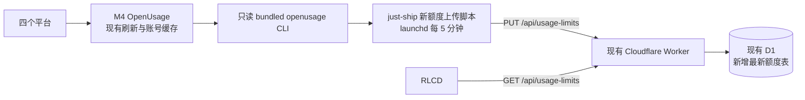

# RLCD weekly usage API research

调查时间：2026-11-09。范围：只读 SSH、源码/文档/既有测试检查、只读额度快照；未改动 M4 代码、配置或运行服务，未触发额度刷新或登录。

## M4 OpenUsage：已验证

主机 `justinyan@macminim4.sgponte`，源码根目录 `/Volumes/T5/github/openusage`，调研时 HEAD 为 `82001b829b1a11c5de6ea84013a07b5a18517ba7`，工作树干净，main 比 upstream/main 超前 16 个提交。以下 `M4:<path>:<line>` 均以该源码根目录为基准。

运行中的应用是 `/Volumes/T5/github/openusage/dist/OpenUsage.app/Contents/MacOS/OpenUsage`。当前源码没有旧版 `GET /v1/limits` HTTP 服务；按 `6736`、`HTTPServer`、`/v1/limits` 搜索源码、文档和相关测试，没有匹配到额度 HTTP server，`lsof -nP -iTCP -sTCP:LISTEN` 也未发现 OpenUsage/6736 监听。现存 `LoopbackCallbackServer` 是登录回调，不是额度 API。

当前受支持的机器接口是 **只读 CLI**：

```sh
/Volumes/T5/github/openusage/dist/OpenUsage.app/Contents/Helpers/openusage
```

它从自身 app domain 读取账号和缓存，输出 `openusage.limits.v2` JSON，不发 provider 请求、不刷新、不登录、不读取凭证、不启动应用。`--force` 在当前版本无效。依据：`M4:docs/cli.md:3`、`M4:Sources/OpenUsageCLI/OpenUsageCLI.swift:16`、`M4:Sources/OpenUsage/Services/UsageReader.swift:14`。

M4 的 `/usr/local/bin/openusage` 仍指向 `/Applications/OpenUsage.app/Contents/Helpers/openusage`，与上述运行 bundle 路径不同。采集端应使用明确的 helper 路径，避免 PATH 指向另一版本或另一 app domain。没有修改此软链接。

本机 `/Applications/OpenUsage.app` 和 M4 `dist/OpenUsage.app` 的 app/helper SHA256 不相同；二者实测都输出 limits v2。因此可以确认契约一致，不能据此声称二进制逐字节相同。

## 实测四个平台的数据

在 M4 使用上述 bundled CLI，退出码 0，`generatedAt=2026-11-09T07:50:55.193Z`。省略账号 ID、邮箱、额外余额等与显示需求无关的数据：

| RLCD 行 | provider kind | resource key | 已用 | 剩余 | 重置时间 UTC | 是否过期 |
| --- | --- | --- | ---: | ---: | --- | --- |
| Claude | `claude` | `weekly` | 50% | 50% | 2026-11-14 05:00:00 | false |
| Codex | `codex` | `weekly` | 49% | 51% | 2026-11-13 08:23:12 | false |
| Kimi | `kimi` | `weekly` | 4% | 96% | 2026-11-13 03:28:15 | false |
| Gemini (Antigravity) | `antigravity` | `geminiWeekly` | 0% | 100% | 2026-11-16 07:49:31 | false |

四条资源均为 `kind=consumption`、`unit=percent`、`limit=100`、`windowSeconds=604800`。账号的 `fetchedAt` 为 07:49:30–31，`expiresAt` 为 07:59:30–31。这些数值只是调研快照，不能写死进固件或当作后续实时值。

当前 ProviderKind 中没有独立 `gemini`，有 `antigravity`。因此本需求的 Gemini 需要标明来自 **Antigravity Gemini weekly pool**，不能解释为 Gemini CLI 或 Gemini 网页套餐。依据：`M4:Sources/OpenUsage/Models/Account.swift:10`、`M4:Sources/OpenUsage/Providers/AccountProviderRuntime+Descriptors.swift:66`。

Kimi 当前已配置且确实报告周额度；不需要新增 Kimi 采集器。但其他 Kimi 套餐可能仅提供月额度，源码不会把残留旧字段当作 weekly。RLCD 应支持“无周额度”，不能将 monthly/5h 偷换成 weekly。依据：`M4:Sources/OpenUsage/Providers/Kimi/KimiUsageMapper.swift:50`、`M4:Tests/OpenUsageTests/KimiUsageMapperTests.swift:6`。

## limits v2 契约及消费规则

实际顶层只有 `schema`、`generatedAt`、`providers`，**没有 v1 的 `errors` 数组**。provider 刷新失败会保留旧值，CLI 不输出错误原因；过了 10 分钟后通过 `stale` 暴露数据陈旧。应用每 5 分钟刷新，失败会退避。依据：`M4:Sources/OpenUsage/Services/LimitsEnvelope.swift:34`、`M4:docs/cli.md:69`、`M4:docs/refreshing.md:3`、`M4:docs/refreshing.md:38`。

```json
{
  "schema": "openusage.limits.v2",
  "generatedAt": "2026-11-09T07:50:55.193Z",
  "providers": {
    "claude@ACCOUNT_ID": {
      "displayName": "Claude · account label",
      "plan": "provider-reported plan",
      "fetchedAt": "2026-11-09T07:49:31.000Z",
      "expiresAt": "2026-11-09T07:59:31.000Z",
      "stale": false,
      "resources": {
        "weekly": {
          "kind": "consumption",
          "unit": "percent",
          "used": 50,
          "limit": 100,
          "remaining": 50,
          "utilization": 0.5,
          "resetsAt": "2026-11-14T05:00:00.000Z",
          "windowSeconds": 604800
        }
      }
    }
  }
}
```

建议消费约束：

- 用稳定账号键 `kind@UUID前8位` 选择账号，不用可重命名且可能含邮箱的 `displayName`。每个平台当前恰有一个账号；以后多账号时显式指定，不平均/相加百分比。依据：`M4:Sources/OpenUsage/Models/Account.swift:111`、`M4:Sources/OpenUsage/Services/UsageReader.swift:16`。
- Claude/Codex/Kimi 只选 `weekly`；Gemini 只选 `antigravity` 的 `geminiWeekly`。不选 Claude 模型独立限额、Codex sparkWeekly、Antigravity nonGeminiWeekly 或 argonWeekly。依据：`M4:Sources/OpenUsage/Providers/AccountProviderRuntime+Descriptors.swift:11`、`:26`、`:66`、`:114`。
- `generatedAt` 是本次导出时间，不代表 provider 刚刷新。必须保留并使用每个平台的 `fetchedAt`/`expiresAt`，转发层不能每次读缓存都让数据“变新”。
- 缺 provider 或 resource 是未知/未提供，不等于使用 0%、剩余 100%。CLI 对从未获取过的账号不输出 entry，未知 provider 参数退出 2，无快照退出 4。依据：`M4:docs/cli.md:26`、`M4:Sources/OpenUsage/Services/LimitsEnvelope.swift:15`。
- 正数 limit 才可计算百分比。需校验 finite 数值、kind、unit、周窗口；显示进度条时限制到 0–100。底层通用 encoder 的 `used` 未限制上界，`remaining=max(0,limit-used)`、`utilization=used/limit`。依据：`M4:Sources/OpenUsage/Services/LimitsEnvelope.swift:84`。
- 对外 API 只导出选中的周额度与时间/状态，不转发邮箱、账号 label、全量 credits、app 内错误文本或凭证。建议让 M4 采集器完成此投影，固件只解析小响应。

## 可复用部分与最小改动建议

OpenUsage 已有四个平台的真实周额度，**无需修改其 provider、登录或缓存实现，也无需为本需求恢复 OpenUsage HTTP server**。采集端调用现有 bundled CLI 是最小接口：读缓存成本低、不触发远端额度轮询，也不会触碰登录流程。

现有常驻/定时服务可以包一层小型 JSON API，或将投影后的最新快照上报现有 Cloudflare Worker。是否已有可复用 Tunnel 和 HTTP origin，需要结合外层部署调研，不能从历史文档推定当前存在。

建议对外契约保持四条稳定 ID，每条带 `usedPercent`、`remainingPercent`、`fetchedAt`、`expiresAt`、`resetsAt`、`status`；`status` 至少区分 `ok`、`stale`、`unavailable`。某条缺失时其数值应为 null/省略。状态由投影服务根据快照可用性和时间计算，不能声称知道 OpenUsage 没导出的登录错误原因。

## 已读测试及未执行项

未运行测试或重新构建远程 app；本轮没有实现修改，且测试可能创建真实窗口。已阅读以下现有测试以核实契约：

- `M4:Tests/OpenUsageTests/LimitsEnvelopeTests.swift:65`：文档 JSON 与 encoder 一致、10 分钟过期边界。
- `M4:Tests/OpenUsageTests/LimitsEnvelopeTests.swift:96`：无快照账号被省略，顶层字段集合固定。
- `M4:Tests/OpenUsageTests/UsageReaderTests.swift:25`：只读 app domain 缓存。
- `M4:Tests/OpenUsageTests/UsageReaderTests.swift:44`：provider kind 匹配全部账号，完整 account ID 选择单个账号。
- `M4:Tests/OpenUsageTests/UsageReaderTests.swift:60`：6 分钟旧值不 stale，11 分钟旧值 stale。
- `M4:Tests/OpenUsageTests/KimiUsageMapperTests.swift:6`：只导出计划实际报告的时间窗口。
- `M4:Tests/OpenUsageTests/KimiUsageMapperTests.swift:73`：无额度/坏响应不能伪装成 0 已用。

后续实现必须额外测试：多个账号选择、源快照停止更新、单平台缺失、周额度重置、malformed JSON/非 finite 百分比、请求超时、认证失败和缓存保留。

## justinyan.app：现有生产链路

以下为 2026-11-09 的源码与只读运行态调查，不是已经实施的新功能。

M4 checkout：`/Users/justinyan/Documents/jproj/just-ship`；本机对应 checkout：`/Users/justinyan/Documents/JProj/Project-ship/just-ship`，二者 HEAD 都是 `2a57454`。本机工作树干净；M4 的 `worker/src/index.ts` 和 `worker/test/wordpress-scheduled.spec.ts` 存在未提交修改。实施时应从干净 checkout 分支开发，先核对远端修改，不能覆盖或顺手部署无关变更。

已验证链路：

```text
M4 / MacBook 的 CLI 本地日志
    → ccusage
    → just-ship/scripts/token-usage-fetcher.mjs
    → HTTPS PUT https://justinyan.app/api/token-usage
    → Cloudflare Worker → D1 token_usage_daily
    → GET /api/token-usage → TokenUsageHeatmap.vue
```

- M4 的 `~/Library/LaunchAgents/me.justinyan.just-ship.token-usage.plist` 调度为每天本地时间 03:00；执行完成后退出，不是额度 HTTP 常驻服务。它读取 `~/.config/just-ship/token-usage.env`，其中源 ID 是 `mac-mini`，上传目标是 `https://justinyan.app`，采集 provider 为 `codex,claude,agy`。日志可见成功上传记录。未打印或复制其密钥。
- 实时 PM2 进程清单与保存清单均未发现 token/usage API 进程；未发现 `cloudflared` 进程或常见配置目录。这里只能断言所检查的 M4 链路未发现 Tunnel，不推断 Cloudflare 账号里不存在其他 Tunnel。
- `worker/wrangler.jsonc:2` 配置同一 Worker 承载 `justinyan.app/*`、Vite 静态资源和 `/api/*`，绑定已有 `just-ship-production` D1；不是回源到 M4 的路由。迁移结论也明确 VPS 部署路径已退休：`docs/wayfinder/cloudflare-migration/final-verdict.md:20`。
- 当前 Worker 的五条 API 路径为 `/api/health`、`/api/content`、`/api/content/days`、`/api/likes`、`/api/token-usage`。入口按 HTTPS/host/method/query/body 白名单拦截：`worker/src/index.ts:4`、`:399`。
- `GET /api/token-usage` 从 D1 按天聚合所有 source/provider 的 token 总数，返回 `startDate/endDate/days`，没有配额分母、剩余百分比或美元 cost。其公共缓存为浏览器 60 秒、边缘 300 秒：`worker/src/index.ts:130`、`:1445`。
- `PUT /api/token-usage` 在解析 JSON 前验证 `X-Usage-Api-Key`，支持 current/previous 轮换密钥；有请求大小上限、精确字段校验、限流、事务批量 upsert，拒绝旧采集覆盖新值：`worker/src/index.ts:171`、`:546`、`:576`、`:630`。这些模式可直接复用。
- `token_usage_daily` 的主键是 `(usage_day, provider, source_id)`，provider 约束只含旧三类。它适合可相加的本地用量，不适合账号级周配额：`worker/migrations/0001_initial.sql:35`。
- 旧采集器有“当天已成功则跳过”的 completion gate，并扫描历史日志：`scripts/token-usage-fetcher-runner-lib.mjs:20`、`:121`。不能把整个旧任务改成每 5 分钟执行来获得实时额度，否则会重复做历史扫描，且可能仍被 completion gate 跳过。

上述 just-ship 文件路径相对两个相同 HEAD 的 checkout；实际运行调度及环境来自 M4。

## 线上只读验证与设备接入细节

2026-11-09 07:52 UTC 从本机 curl 获取 `/api/token-usage` 为 200，JSON 字段符合源码，最新条目为当日；从 M4 curl 获取 `/api/health` 为 200，返回 `{"status":"ok"}`。未执行任何 PUT、部署或远程 D1 查询。

同轮默认 Python urllib 请求收到 Cloudflare 403、`error code: 1010`；用诚实标识应用的 `User-Agent: rcink-research/1.0` 重试只读 health 请求返回 200。固件应固定发送例如 `rcink-rlcd/1.0` 和 `Accept: application/json`，不能假定任意 HTTP 客户端默认值都可通行。Cloudflare 官方对 1010 也说明了默认 Python UA 被 Browser Integrity Check 拒绝，以及使用描述性应用 UA 的处理方式：[Error 1010](https://developers.cloudflare.com/support/troubleshooting/http-status-codes/cloudflare-1xxx-errors/error-1010/)。这不能代替 ESP32 真机 HTTPS 验收。

未检查 Cloudflare 控制台里的实时 WAF、secret、DNS 和 deployment revision；源码配置、线上响应与运行态调度足以确认推荐接入点，但不宣称已审计整个账号。

## 推荐方案：扩展现有 Worker，M4 定时上传周额度



建议复用现有 Cloudflare Worker + D1。这样 M4 只负责向外上传；M4 暂停、断网或应用退出时，公网 API 仍能返回最后快照及真实过期状态。无需新增 Tunnel、HTTP origin、第二个 Worker 或数据库。Cloudflare Tunnel 是把源站通过 `cloudflared` 连接到边缘的另一种结构，本次没有发现需要复用的这类额度服务：[官方 Tunnel 说明](https://developers.cloudflare.com/cloudflare-one/networks/connectors/cloudflare-tunnel/)。

### 1. M4 采集

在 just-ship 新增 `scripts/usage-limits-fetcher.mjs` 及小型测试，调用运行 bundle 内 helper 的绝对路径。用一个独立 launchd job 每 300 秒运行，登录后启动；不修改每日 token 采集的时间和 completion gate。不需要常驻 Node HTTP 服务。

采集器读取 `openusage.limits.v2`，根据私有配置中的四个稳定 account ID，选择 Claude/Codex/Kimi 的 `weekly` 和 Antigravity 的 `geminiWeekly`。当前账户 ID 的映射存 M4 私有配置，不提交到仓库，不把邮箱和其它资源上传。若配置缺失且有多个同类账户，报告明确错误，不取字典中的第一项。

只提交校验通过的已知周资源。校验 schema、kind、unit、`windowSeconds=604800`、finite 数值、正数 limit、时间戳顺序。源值可以超过上限时，百分比展示归一到 0–100，剩余不小于 0；统一在投影层计算 used/remaining，避免二者因独立舍入不相加为 100。重试沿用原 provider 的 `fetchedAt` 和 `expiresAt`，不能用本次导出时间刷新陈旧数据。

使用现有 Node runtime 和 fetch/child_process，不增加依赖。为 CLI 和 HTTP 设置超时；使用现有运行锁模式阻止重叠。不把 API key 写进命令行、日志或明文提交文件。

### 2. Worker 新增 GET / PUT `/api/usage-limits`

建议在现有 Worker 上增加一个独立资源，保留 `/api/token-usage` 契约。

| 操作 | 调用方 | 鉴权 | 行为 |
| --- | --- | --- | --- |
| `PUT /api/usage-limits` | M4 uploader | 复用现有写入 key 和 current/previous 校验 | 写入最多四条已选周额度 |
| `GET /api/usage-limits` | RLCD | 新增独立只读 key，例如 `X-Usage-Read-Key` | 返回四个固定槽位的最新快照 |

公网可达不必等于匿名公开。设备只持有读取额度所需的 key，不能拿到现有 token 写入 key。新的读密钥缺失时只让新路由返回配置错误；不影响原网站已有功能。继续沿用边界校验、HTTPS、参数化 SQL、速率限制、结构化日志，日志只记录状态/数量。

推荐响应示例（为契约示例，不是已上线接口）：

```json
{
  "schema": "rcink.usage-limits.v1",
  "servedAt": 1794210655,
  "providers": [
    {
      "id": "claude",
      "status": "ok",
      "usedPercent": 50,
      "remainingPercent": 50,
      "fetchedAt": 1794210571,
      "expiresAt": 1794211171,
      "resetsAt": 1794632400
    }
  ]
}
```

实际固定顺序为 `claude, codex, kimi, gemini`；示例省略后三项。时间采用 UTC epoch seconds，减少 ESP32 的日期解析代码。Gemini 的界面标签应标明 Antigravity。`status` 为 `ok/stale/unavailable`：

- `ok`：有通过校验的快照，尚未到源 `expiresAt`。
- `stale`：保留最后成功值，但源快照已过期；`resetsAt` 已过而还没有新快照时也不能展示成当前有效额度。
- `unavailable`：从未收到该平台有效周额度，百分比和时间为 null；不制造 0%/100%。

若单平台此次缺失，采集器省略该条，D1 保留它的最后成功快照，仍按原时间过期。整次采集失败不上传空值覆盖成功数据。GET 按当前时间重新计算状态，不永久存一个可能变旧的 `stale=false`。

第一版读取量很小，使用 `Cache-Control: no-store`，不复用匿名公共 projection cache，避免私有响应缓存与过期标志滞后问题。

### 3. D1 只存最新快照

新增 `0004_usage_limit_snapshots.sql`，序号在实施前重新确认。第一版只有 M4 是该数据的写入源，表以稳定展示槽 `provider` 为主键，包含 `source_id`、`used_percent`、`fetched_at`、`expires_at`、`resets_at`、`received_at`。不存历史，不混入 `token_usage_daily`，不累计多台 Mac 的同一账号额度。

仅接受配置的 `mac-mini` 源与四个合法槽位；用 `fetched_at` 做单调 upsert，重复快照幂等，旧数据不可覆盖新数据。一次上传先完整校验，再批量事务写入。`received_at` 用于排障，不能用它计算数据新鲜度。显式账号切换作为后续受控配置变更，不靠比较新旧账号的百分比猜测。

剩余百分比由已用比例派生，不需要再存一份。GET 固定输出四项，缺行输出 unavailable。约 288 次上传/日、最多 1,152 行 upsert/日；RLCD 每 5 分钟读取为 288 次 GET/日。

2026-11-09 已按官方价格进一步核算，并由用户接受五分钟周期：30 天约 34,560 行数据更新，占 Workers Paid 每月含 5,000 万行 D1 写入的 0.069%；超额单价为每百万行 $1，此规模即使全按超额算也约 $0.035/月（不含索引额外写入）。上传加一台设备读取共 17,280 个 Worker 请求/月，占每月含 1,000 万请求的 0.173%。CPU 另计，索引维护可能增加写入数；额度由账户共享，本轮未读取实际整账户用量。只保留四条最新值；跳过相同 fetchedAt 的重复快照，但新采样即使百分比未变也更新时间。依据：[D1 价格](https://developers.cloudflare.com/d1/platform/pricing/)、[Workers 价格](https://developers.cloudflare.com/workers/platform/pricing/)。

### 4. RLCD 接入

在 `firmware/rlcd` 内新增额度 HTTPS client、纯逻辑解析/页面构造和测试；复用现有后台刷新、NVS 缓存、显示驱动、按键导航。网络 worker 只取数据，主任务应用结果/写缓存/渲染，保持当前线程边界。

该设备配置选择 usage API 数据源；未配置 usage API 的既有 RLCD 构建继续使用原 Axiom 路径，其它 firmware target 无需改动。新的 usage 页作为现有 Deck 的一页，并可将它设为这台设备保存的启动视图；温湿度 Dashboard 仍可按键切回。可把归一化数据构造成现有 DSL/PageRecord 以复用渲染与缓存，同时必须保存每个平台的源时间，不能仅靠当前 `last_fetch_s` 判定 fresh。

页面使用四条横向进度条，主要数字是剩余百分比，辅以已用百分比；每行标出 weekly 和必要的陈旧状态，底部给采样时间或年龄。未知值用 `--`，不能画成满额。按源 `resetsAt` 显示重置提示，无需用固定日历周推算。

接 Mac 的 HOST 模式建议每 5 分钟拉取，需调整当前固定 15 分钟的 `power/network_policy.h`。电池模式先保留现有节能调度和按键唤醒；显示真实采样时间，源过期后标旧。设备本地必须在断网期间继续根据 `expiresAt` 更新陈旧标记，而非等下次 HTTP 成功才更新。后续若要电池模式也实时，单独实测耗电后调小周期。

TLS 校验必须启用，选择适合 `justinyan.app` 的 CA/bundle，不能把 Axiom 的 CA 或 `setInsecure()` 当作通用方案。先同步 NTP/RTC，处理时间未校准状态；HTTPS 超时/401/429/坏 JSON/超大响应保留最后好快照并显示相应状态。设备请求采用描述性 User-Agent，限制响应体大小，不将读取 key 跟随任意重定向发送。

可复用的本仓库实现位置：`firmware/rlcd/src/net/refresh_flow.cpp`、`refresh_controller.cpp`、`src/main.cpp:133`、`src/render/page.cpp`、`src/input/navigation.h`、`firmware/shared/rcink-core/src/store/nvs.cpp`。现有 `deck_is_stale()` 只看 HTTP 最近成功时间，必须为额度页补充源时间判断，否则 M4 已停更而 Worker 仍响应 200 时会误报新鲜。

## 实施顺序与验收

1. 在干净 just-ship checkout 新建开发分支，实现投影/采集器、Worker 新路由、D1 增量 migration、示例配置和部署说明。用匿名化真实形状 fixture 验证四平台、多账号、缺项、过期、周重置和时间单位。
2. 运行采集器单测、Worker type check/Vitest 和 migration 测试；复查旧 token read/write、缓存、router whitelist、安全日志测试。读 key 不可 PUT、无 key 不可 GET、超过 4 项/坏时间/非有限比例应拒绝；旧快照不能覆盖新快照。
3. 完成 Cloudflare dry-run。实际部署阶段先应用增量 D1 schema，再部署 Worker 和读 key，最后启用 M4 的 5 分钟 uploader，避免客户端先于 API 上线。保持原日采集不变。
4. RLCD 先跑 native parser/layout/调度测试，再构建、核对 USB MAC、备份当前固件后刷入。对照 M4 CLI、新 GET 响应、设备 serial state 和真实 framebuffer，确认四条比例一致且 400×300 不裁切。
5. 验证 M4 停更、单平台缺失、设备 Wi-Fi 断开及重启：最后成功值保留、过期准确、未知不当 100%、NVS 恢复正常。验证配额重置后下降被接受。检查温湿度页、按键、HOST/ECO 切换。
6. 回退时停新 uploader、回退 Worker 版本和设备固件即可；新 D1 表可保留，不需要破坏旧表。

建议实现范围为 **just-ship + rcink 两个 repo**。OpenUsage 暂无代码改动；不新增网页登录、OAuth collector、历史额度图、Tunnel 或通用 dashboard 平台。

本轮产物只有该调研文档；未实现上述方案、未跑修改后测试、未部署、未刷机。后续部署前还需核实实际 Cloudflare secrets/WAF 配置、使用中的 Wi-Fi，以及远端未提交变更的归属。
